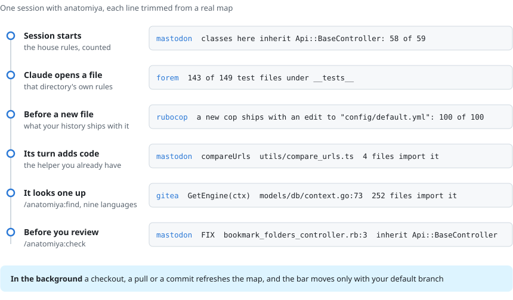

<p align="center">
  <picture>
    <source media="(prefers-color-scheme: dark)" srcset="docs/assets/logo-dark.svg">
    
  </picture>
</p>

<h3 align="center">New to the codebase? So is your coding agent.</h3>

<p align="center">
  anatomiya reads your repository and its git history, then teaches Claude Code what a senior teammate
  teaches you in your first week: where files go, which helpers already exist, how tests are written
  here, and what has to change together.
</p>

<p align="center">
  <a href="https://github.com/crisnahine/anatomiya/actions/workflows/ci.yml"></a>
  <a href="https://github.com/crisnahine/anatomiya/releases/latest"></a>
  <a href="LICENSE"></a>
  
  
</p>

<p align="center">
  <picture>
    <source media="(prefers-color-scheme: dark)" srcset="docs/assets/session-dark.svg">
    
  </picture>
</p>

## What it does

anatomiya scans your repository and its git history, keeps the result current on its own, and hands
Claude each part at the moment it matters. Everything it says is counted from your code, with the
count beside it, so Claude can tell a habit from an accident.

| When | What Claude gets | A real line from a map |
|---|---|---|
| Every session | The house rules: how this repository handles errors, auth, logging, time, HTTP, naming | mastodon `app/controllers/api/v1`: classes here inherit `Api::BaseController`: 58 of 59 |
| When it opens a file | That directory's own rules, where its tests live, and what the rest of the repository imports from it | forem `app/javascript`: 143 of 149 test files under `__tests__` |
| Before it writes a new file | What your history ships with that kind of file | rubocop: a new cop ships with an edit to `config/default.yml`: 100 of the last 100 |
| When its turn adds code | A subagent looks for a function that already does the job, starting from the code index, and Claude is asked to call it | mastodon: `compareUrls` in `app/javascript/mastodon/utils`, 4 files import it |
| Whenever it asks | `/anatomiya:find <words>` looks up the functions, classes and types the scan read, each with its parameters, its doc and how many files import it | gitea: `GetEngine(ctx context.Context)  models/db/context.go:73  fn, 252 files import it` |
| Before you review | `/anatomiya:check` lists each habit the branch broke, at the line that broke it | `FIX "app/controllers/api/v1/bookmark_folders_controller.rb":3  classes here inherit Api::BaseController` |

The map keeps up on its own: a checkout, a pull or a commit starts a refresh in the background. The
checks measure against a baseline of code a person accepted, and that baseline moves only with
commits that came to your default branch from the remote, so Claude cannot lower the bar it is
judged by.

It reads JavaScript, TypeScript, JSX, Flow, Ruby and Rails in depth, the script blocks of Vue and
Svelte, and Python, PHP, Go, Java, C#, Rust and Kotlin, plus the views written in ERB, HAML, Slim,
Blade, Razor, Jinja, Twig and Go templates. Cursor and GitHub Copilot get the same map.

## Try it in your repository

```
/plugin marketplace add crisnahine/anatomiya
/plugin install anatomiya@crisnahine
/anatomiya:scan
```

That is the whole setup. The first scan took 1.1 seconds on excalidraw's 693 files and 13 seconds on
forem's 4,687, and a rescan of forem about 3
([measured](docs/measurements/2026-10-25-readme-examples.md#scan-time)). The scan runs on your machine,
and anatomiya itself sends nothing anywhere. You need Node 22 or newer, and for
Ruby, `ruby` with `prism` 1.x (Ruby 3.4 ships it). [More ways to install](#more-ways-to-install) are
further down.

## A closer look

### The house rules your linter cannot see

`/anatomiya:scan` reads every tracked file and your git history, and writes a map Claude Code loads
on its own: a short overview on every turn, and one file per directory the moment Claude opens a file
there. These are real lines from maps of open-source repositories, each with its commit in
[the examples page](docs/measurements/2026-10-25-readme-examples.md):

| What Claude learns | Where | What the map says |
|---|---|---|
| which base class carries the API's auth and errors | mastodon `app/controllers/api/v1` | classes here inherit `Api::BaseController`: 58 of 59 |
| how request parameters are filtered | mastodon `app/controllers/admin` | request parameters are filtered through `params.expect`: 37 of 37 |
| which HTTP client to use | mastodon `app/javascript/mastodon/actions` | network calls go through the repository's own client, not fetch directly: 91 of 94 |
| what a migration may touch | [forem](https://github.com/forem/forem) `db/migrate` | migrations change the schema and leave the data alone: 927 of 936 |
| how time is read | [whitehall](https://github.com/alphagov/whitehall) `test/unit/app/models/edition` | times are read and built through the application time zone: 21 of 21 |
| which helpers already exist | mastodon `app/javascript/mastodon/utils` | most imported from here: ..., `compareUrls` (4 files) |
| where tests live | forem `app/javascript` | 143 of 149 test files under `__tests__` |
| what ships together | [rubocop](https://github.com/rubocop/rubocop) `lib/rubocop/cop/style` | a new cop ships with an edit to `config/default.yml`: 100 of the last 100 |

A habit becomes a rule only when it holds in at least 90% of places, across enough files and
authors. A habit Claude already follows on its own is shown as a count instead, so the map spends
context only where Claude would go wrong. The overview was 2.3 to 3.4 KB on the five repositories
measured here.

### A word before a file skips a step

In rubocop, the first write of a new cop gets this, before the file exists:

```text
anatomiya: lib/rubocop/cop/style/reverse_first.rb
  A .rb file added here ships with a new .md file in "changelog": 97 of the last 100 changes that added one.
  A .rb file added here ships with an edit to "config/default.yml": 100 of the last 100 changes that added one.
  A .rb file added here ships with an edit to "lib/rubocop.rb": 99 of the last 100 changes that added one.
  Make those changes in the same change, or say why this file does not need them.
```

It says the same kind of thing when a test is about to land in a directory that keeps none. On every
other write it says nothing.

### The helper your repository already has

<p align="center">
  <picture>
    <source media="(prefers-color-scheme: dark)" srcset="docs/assets/results-dark.svg">
    
  </picture>
</p>

Fourteen small tasks in thirteen open-source repositories, each asking for code the repository
already had a function for: seven in JavaScript, TypeScript and Ruby, and one in each of Python, PHP,
Go, Java, C#, Rust and Kotlin. 20 sessions with anatomiya and 20 without, per task, on two models.
**With anatomiya, 542 of 560 sessions called the function that was already there. Without it, 291
of 560 did.**

No prompt named the function, and every check was fixed in a scenario file before the first session
ran. For ten of the tasks, a rule committed ahead of its picks chose the repository, the helper and
the place for the new file ([the 0.19.0 results and how each task was picked](docs/measurements/2026-10-26-every-language.md)).

Here is what that looks like. The task: show a "You are here" badge in
[mastodon](https://github.com/mastodon/mastodon) when two links point to the same page. mastodon
already has `compareUrls` for exactly that, in `app/javascript/mastodon/utils/`, one folder over
from where the badge goes.

Every session without anatomiya wrote its own URL comparison. Every session with it called
mastodon's. Here is the difference between one session from each, trimmed to the lines that
differ: red is without anatomiya, green is with it.

```diff
- const toPageKey = (href: string) => {
-   try {
-     const url = new URL(href, window.location.href);
-     return `${url.origin}${url.pathname}${url.search}`;
-   } catch {
-     return null;
-   }
- };
+ import { compareUrls } from '../utils/compare_urls';

  export const CurrentPageBadge: FC<{ href: string; currentHref: string }> = ({
    href,
    currentHref,
  }) => {
-   const pageKey = toPageKey(href);
-   if (pageKey === null || pageKey !== toPageKey(currentHref)) {
+   if (!compareUrls(href, currentHref)) {
      return null;
    }
```

Same prompt, same commit, same model, Claude Opus 5.5. The median component was 37 lines without
anatomiya and 27 with it. Claude Haiku 5.5 did the same: 0 of 20 without, 20 of 20 with. Every
component both arms wrote is in [the evidence file](docs/measurements/data/2026-10-25-mastodon-components.json).

How it got there: in the first run, 35 of the 40 sessions with anatomiya say they wrote their own comparison first,
then replaced it with `compareUrls`. That is the order anatomiya's end-of-turn check asks for: when
a turn adds code, it has a subagent look for an existing function that does the same job. The session
below is rebuilt from one of those.

The same thing happened in forem, where 28 of 40 sessions without anatomiya skipped the contrast
helper forem already has, in whitehall, where 36 of 40 skipped `is_external?` and 26 of them compared
hosts in their own code, and in atuin, where 35 of 40 Rust sessions called the uuid crate's
`Uuid::now_v7` instead of the repository's `uuid_v7`. With anatomiya, all 120 of those sessions called
the helper.

It did not win everywhere. In seven of the fourteen language pairs both arms called the helper every
time: gitea calls `db.GetEngine` from 246 files and Bitwarden builds every id with
`CoreHelpers.GenerateComb`, so a session follows the files next to it with or without a map, and
anatomiya only cost more. On gitea with Claude Haiku 5.5 the arm without it did better, 20 against 18:
both misses called the repository's own `db.Count`, which calls `GetEngine` itself. Every result
prints the sha256 of the scenario file it was scored by. [The whole test](#the-whole-test-ties-included)
is below, with every miss read.

<p align="center">
  
</p>

### Look it up before writing it: the code index

Every scan also writes an index of every function, method, class and type a file declares at its top
level or in a class, and Go's and Rust's constants and package variables, in all nine languages (a view template is not
indexed): where it is, what it takes, the first sentence of its doc comment, and how many other
files import it. `/anatomiya:find` asks it in plain words, and a name in any casing works:

```text
/anatomiya:find uuid v7
The 6 of 9995 indexed definitions closest to "uuid v7", as of the last scan:
uuid_v7()  crates/atuin-common/src/utils.rs:34  fn, 19 files import it
NotUuidV7  crates/atuin-octavo/src/pb.rs:19  type, 1 file imports it
```

A rare word counts for more than a common one, a function many files already call ranks higher, and
a test ranks behind the function it covers. One call prints at most six lines. The end-of-turn
check hands the same command to its subagent, at most three calls: measured on two reuse tasks, its
search spent a quarter to a half less fresh input and a third less output than the same check with no
index, and found the helper in 18 of 20 sessions against 16 ([A124](docs/decisions/A124.md)). No hook reads the index; the refresh rewrites it with
the map, and django's 39,257 definitions take 633 KB on disk.

### Before you review: what this branch broke

`/anatomiya:check` compares the branch with its merge base, uncommitted work included. A new mastodon
API controller that inherits `ApplicationController`:

```text
FIX  "app/controllers/api/v1/bookmark_folders_controller.rb":3  classes here inherit Api::BaseController
  BookmarkFoldersController: 58 of 59 baseline sites conform
```

A new rubocop cop written alone:

```text
1 MUST-FIX, 2 FIX, 0 NIT

MUST-FIX  "lib/rubocop/cop/style/reverse_first.rb":1  a .rb file added to "lib/rubocop/cop/style" ships with an edit to "config/default.yml"
  all 100 of the last 100 changes that added one; no "config/default.yml"
```

MUST-FIX means the code you accepted has no exception to the habit at all. Nothing is blocked, and
`--format github` turns each finding into an annotation on the pull request.

## The whole test, ties included

Fourteen reuse tasks in thirteen open-source repositories, measured on 0.19.0, and four tasks of
another kind from the first run. For each, 20 sessions with anatomiya and 20 without, the same prompt
at the same commit, scored by checks written down before the first session. Then the whole run again
on a second, smaller model. Bold marks a difference with p below 0.05 by Fisher's exact test.

Where the code the task needed already existed in another directory:

| Task | What was checked | Opus 5.5 with / without | Haiku 5.5 with / without |
|---|---|---|---|
| mastodon: a "You are here" badge | calls the existing `compareUrls` | **20 / 0** | **20 / 0** |
| forem: a contrast warning | calls the existing WCAG contrast helper | **20 / 2** | **20 / 10** |
| whitehall: an external link helper | calls the existing `is_external?` | **20 / 1** | **20 / 3** |
| mastodon: a link policy | calls the existing `TagManager#local_url?` | **20 / 15** | **11 / 1** |
| eslint: a linter test (picked by a rule) | calls the existing `unIndent` | **17 / 1** | **17 / 0** |
| openfoodnetwork: a Stimulus controller (picked by a rule) | calls the existing `showHttpError` | 20 / 19 | **20 / 7** |
| cal.diy: an app key reader (picked by a rule) | calls the existing `getAppKeysFromSlug` | **20 / 9** | **20 / 0** |

One task per language, each picked by a rule:

| Language | Task | What was checked | Opus 5.5 with / without | Haiku 5.5 with / without |
|---|---|---|---|---|
| Python | CTFd: an admin report route | calls the existing `admins_only` | 20 / 20 | 20 / 17 |
| PHP | BookStack: the admin role's users | calls the existing `Role::getSystemRole` | **20 / 2** | 20 / 19 |
| Go | gitea: a count of inactive users | calls the existing `db.GetEngine` | 20 / 20 | 18 / 20 |
| Java | DolphinScheduler: a schedule reader | calls the existing `JSONUtils.parseObject` | 20 / 20 | 19 / 20 |
| C# | Bitwarden: an import batch record | calls the existing `CoreHelpers.GenerateComb` | 20 / 20 | 20 / 20 |
| Rust | atuin: a script run's id | calls the existing `uuid_v7` | **20 / 5** | **20 / 0** |
| Kotlin | KotlinConf: an empty list message | calls the existing `PreviewHelper` | 20 / 20 | 20 / 20 |

Where the habit could be seen in the files next to the change, measured on 0.18.0:

| Task | What was checked | Opus 5.5 with / without | Haiku 5.5 with / without |
|---|---|---|---|
| rubocop: a new cop | registers it in `config/default.yml` and adds a changelog entry | 20 / 20 and 20 / 20 | 20 / 20 and 17 / 15 |
| forem: a module and its test | puts the test in `__tests__` and none beside the module | 20 / 20 | 20 / 20 |
| forem: a service object | its entry point does not raise | 20 / 20 | 20 / 20 |
| whitehall: a migration | updates `db/schema.rb` too | 20 / 20 | 20 / 20 |

Read it straight. Of the 28 task and model pairs where the answer lived in another directory,
anatomiya changed the result in 16, and the arm without it never did better by a margin a test
can tell from chance. Of the rest, most are ties at or near 20 on both arms, where the helper is the
repository's idiom and a session finds it without a map. The misses with anatomiya mostly named the
helper and chose another: on eslint, sessions kept a helper of their own because `unIndent` strips
spaces and eslint indents with tabs, or called `stripIndent` from a package eslint already has; on
mastodon's link policy, Haiku sessions called `TagManager#local_uri?`, the method beside `local_url?`;
on gitea, the repository's own `db.Count`. Where the neighbouring files already showed the habit, both
models followed it without help, and anatomiya added only cost.

One thing the map asked for was out of date: rubocop moved cop registration out of `lib/rubocop.rb`
in [e9defb6](https://github.com/rubocop/rubocop/commit/e9defb651dff92627ac49ddca76211011c7cf08c), the
map still counted the hundred changes before it, and the files every session wrote show both arms on
both models followed the code instead, 20 of 20.

[The 0.19.0 write-up](docs/measurements/2026-10-26-every-language.md),
[the blind replication](docs/measurements/2026-10-26-blind-replication.md) and
[the first write-up](docs/measurements/2026-10-25-plugin-on-off.md) have every check, every interval,
what they do not show, and how to rerun them. Each task has its own page and a record of every
session, and the 0.19.0 write-up has a trap task where the user hands over the exact code: one session
in 20 with anatomiya swapped in a look-alike helper that answers differently, and said so.

## What it costs

It is free and MIT licensed. What you pay is tokens:

- **On every session**: the six command entries, about 30 tokens each by `claude plugin details` (measured on the five 0.19.0 shipped; `find` is new), and the
  overview, 2.3 to 3.4 KB on the repositories above. In a long session the overview is handed back
  about every 30k tokens. A directory's own file, 0.5 to 2.3 KB at the median, loads when Claude opens
  a file there.
- **On each turn that adds code**: one subagent searches for an existing function. That search is
  what found `compareUrls`. Where the scan wrote a code index, the subagent starts from `find`.
- **Measured**: across the fourteen tasks on 0.19.0, the median session with anatomiya cost 2.0 to
  5.5 times as much as one without. On Opus 5.5 that was $0.29 to $0.50 against $0.067 to $0.18 per
  session. On Haiku 5.5 it was $0.010 to $0.029 against $0.003 to $0.009. On a turn that only pasted
  code the user wrote out, the search still ran, and the trap task cost 27 times as much with
  anatomiya.

## Why I built it

I built anatomiya when I started at a new company. I wanted my coding agent to write code the way that
repository already did. All of it was there, in the code and in its history, and an agent starts every
session with no memory of the last review. The research says the same thing happens to people and to
agents:

- At Google, "developers who have started within the past year typically have more than twice as
  many comments per change" ([Sadowski et al., ICSE-SEIP 2018](https://research.google/pubs/modern-code-review-a-case-study-at-google/)).
- Of 567 pull requests written with Claude Code across 157 projects, 83.8% were merged, against 91.0%
  for a matched set written by people, and the authors found agents "often underperform on
  project-specific style rules" ([Watanabe et al., arXiv:2509.14745](https://arxiv.org/abs/2509.14745)).
- In 617 pull requests to one Python project, agent-written code repeated logic the project already
  had about 1.87 times as much as code written by people
  ([Huang et al., MSR 2026](https://arxiv.org/abs/2601.21276)).

[What a new developer meets](docs/research/what-a-new-developer-meets.md) has the rest of the
evidence, and where it runs out.

## Questions you should ask first

**Does it send my code anywhere?** No. It runs on your machine. The only command that goes online is
`/anatomiya:setup`, which installs the parser packages from npm. The reuse search is an ordinary
subagent in your own session.

**Will it block a commit or a merge?** No. Nothing it writes blocks a commit, a push or a merge.
`check` reports, and you decide.

**What if the map says something wrong?** Every rule carries its evidence, and every overview tells
Claude that where the map and the code disagree, the code is right. The map rebuilds itself on the
next checkout or pull.

**Should I commit the map?** Usually not, and [the exclude lines below](#more-ways-to-install) keep
it out of git. A team can commit it instead, and the background refresh then leaves it alone.

**Does it work in CI?** `node plugins/anatomiya/bin/anatomiya.mjs check . --format github` prints one
annotation per finding, and `--format json` gives a job the same answer as a record.

**Does it work outside Claude Code?** Cursor and GitHub Copilot get the same map, written where each
one reads it, with `scan --targets cursor,copilot`. The hooks are Claude Code's, so those tools get
the map and not the notice, the reuse check or the background refresh.

**Which languages?** JavaScript, TypeScript, JSX, Flow, Ruby and Rails are read in depth, and so are
the script blocks of Vue and Svelte files. Python, PHP, Go, Java, C#, Rust and Kotlin get the layout,
their tests, the code index, and two to six habits each. In all, 68 dimensions: 29 for JavaScript, 34 reachable in
JSX, 28 for Ruby, and one more that runs the TypeScript checker where your dependencies are installed.
Every one of those languages gets the reuse check and the "most imported from here" line, and so do
the views written in ERB, HAML, Slim, Blade, Razor, Jinja, Twig and Go templates. Measured on one task
per language, anatomiya changed the result in PHP on Opus and in Rust on both models; in the others a
session found the repository's own helper with or without it.

## What it will not do

- **It does not catch bugs.** Of 317 defect comments measured across ten repositories, 1 was
  preventable by a map like this one. It catches code that works and does not belong.
- **It is not a linter.** It enforces nothing, and a rule your linter already enforces is wasted in
  the map.
- **A directory's file loads on a read.** An agent that only greps and runs `cat` gets the overview
  and not the directory's file.
- **A habit that just changed can lag.** A ship-together rule stays until the newest changes outweigh
  it. rubocop moved cop registration out of `lib/rubocop.rb` in July 2026, and the map above still
  asks for that edit.
- **Some lines are fixed sentences.** Every overview asks Claude to read a file before editing it, to
  look instead of guessing, and to follow the repository through to the end of a change. Where the
  counts call for it, one more says a standing instruction to always write a test does not override a
  directory with no test precedent, so it can win over your own instruction.
  [docs/usage.md](docs/usage.md#limits) lists each one and what it rests on.

## More ways to install

`/anatomiya:doctor` says what loaded, `/anatomiya:setup` repairs an install that stopped short, and
`/anatomiya:pin` accepts the current code as the baseline by hand for a repository with no remote. The
three runtime dependencies, `oxc-parser`, `flow-remove-types` and `web-tree-sitter`, are installed by
`/plugin install` itself.

Without Claude Code it is a plain CLI:

```
git clone https://github.com/crisnahine/anatomiya
cd anatomiya && npm install --ignore-scripts
node plugins/anatomiya/bin/anatomiya.mjs scan /path/to/your/repo
```

To keep the map out of git:

```
exclude="$(git rev-parse --git-common-dir)/info/exclude"
echo '.claude/rules/anatomiya-*.md' >> "$exclude"
echo '.claude/anatomiya/' >> "$exclude"
echo '.cursor/rules/anatomiya-*.mdc' >> "$exclude"
echo '.github/instructions/anatomiya-*.instructions.md' >> "$exclude"
```

For worktrees Claude Code creates, a `.worktreeinclude` at the repository root carries the map and its
baseline into each one:

```
**/.claude/rules/anatomiya-*.md
**/.claude/anatomiya/facts.json
**/.claude/anatomiya/layout.json
**/.claude/anatomiya/baseline.json
```

[docs/usage.md](docs/usage.md) has every command, option and edge case.

## Learn more

- [docs/usage.md](docs/usage.md): the full guide.
- [docs/why.md](docs/why.md): why it is built this way, and the designs the measurements replaced.
- [docs/how-it-works.md](docs/how-it-works.md): the mechanics, close enough to predict a scan's output.
- [DECISIONS.md](DECISIONS.md): 367 numbered decisions, each with the measurement or review finding
  that forced it.
- [docs/measurements/corpus.md](docs/measurements/corpus.md): every repository a measurement ran on,
  with its commit.

## Development

```
npm install --ignore-scripts
node --test 'test/**/*.test.mjs'
npm run check:docs
```

ES modules, Node 22 or newer. CI runs the suite and an end-to-end scan, pin and check on Linux, macOS
and Windows on every commit. [CONTRIBUTING.md](CONTRIBUTING.md) has the bar a new habit has to clear
and the release checklist.

## License

[MIT](LICENSE)

P.S. Don't take the headline on faith. Clone mastodon at `3f5c32f`, then
`node scripts/ab-scenario.mjs --repo <that clone> --scenario scripts/ab/scenarios/mastodon-reuse-and-i18n.json --model claude-opus-5-5 --trials 20`
reruns it on your own machine, with your own Claude Code.
