<p align="center">
  <picture>
    <source media="(prefers-color-scheme: dark)" srcset="docs/assets/logo-dark.svg">
    
  </picture>
</p>

<h3 align="center">New to the codebase? So is your coding agent.</h3>

<p align="center">
  anatomiya reads the repository and its git history and hands you both the house style on day one:
  where things go, which base classes and helpers the team uses, how tests are written, and what has to
  change together. Then it checks your branch against it before your reviewers do.
</p>

<p align="center">
  <a href="https://github.com/crisnahine/anatomiya/actions/workflows/ci.yml"></a>
  <a href="https://github.com/crisnahine/anatomiya/releases/latest"></a>
  <a href="LICENSE"></a>
  
  
</p>

<p align="center">
  
</p>

## Why this exists

I built anatomiya when I started at a new company. I wanted my coding agent to write code the way that
repository already did: its house style, its conventions, its patterns. All of it was there, in the
code and in its history, and an agent starts every session with no memory of the last review.

So anatomiya reads it out of the code. It answers the questions a new developer asks a senior teammate
in the first week, and it answers them with evidence you can check:

- Where does a file like this go, and how are its tests written here?
- Which base class does this kind of class inherit, and what does the team call things?
- Is there already a helper for this?
- When I add one of these, what else has to change with it?
- Which habits does the team hold to everywhere, and which are only habits in one corner?

The answers go where Claude Code reads them, and they are plain Markdown, so you can read them too.

It is not only you, and it is not only your agent:

- "The biggest single frustration, cited by 66% of developers, is dealing with 'AI solutions that are
  almost right, but not quite'" ([Stack Overflow Developer Survey 2025](https://survey.stackoverflow.co/2025/ai)).
- At Google, "developers who have started within the past year typically have more than twice as
  many comments per change" ([Sadowski et al., ICSE-SEIP 2018](https://research.google/pubs/modern-code-review-a-case-study-at-google/)).
- "75 percent of defects found during the review do not affect the visible functionality" of the
  software. Most review is about how code is written, not whether it runs
  ([Mantyla and Lassenius, IEEE TSE 2009](https://doi.org/10.1109/TSE.2008.71)).
- Of 567 pull requests written with Claude Code across 157 projects, 83.8% were merged, against
  91.0% for a matched set written by people. Style fixes were 23.4% of the revisions made before
  merge, and the authors found agents "often underperform on project-specific style rules"
  ([Watanabe et al., arXiv:2509.14745](https://arxiv.org/abs/2509.14745)).
- In 617 pull requests to one Python project, agent-written code repeated logic the project already
  had about 1.87 times as much as code written by people, and reviewers did not react to it
  ([Huang et al., MSR 2026](https://arxiv.org/abs/2601.21276)).

[docs/research/what-a-new-developer-meets.md](docs/research/what-a-new-developer-meets.md) has the
rest of the evidence, and where it runs out.

## 20 out of 20, against 0 out of 20

Same task, same commit, same model, 40 sessions in the open-source
[mastodon](https://github.com/mastodon/mastodon) repository. The task: add a badge that says "You are
here" when two links point to the same page.

- **Without anatomiya**, Claude Opus 5.5 wrote its own URL comparison in all 20 sessions.
- **With anatomiya**, all 20 sessions called `compareUrls`, the helper mastodon already had.

The pass and fail checks were written down before the first session ran. The scorer, every session's
record and the command that reruns it are in this repository.

Now the part you should weigh just as hard. In the other four tasks, Claude already did what the
repository does without any help, so anatomiya changed nothing there, and every session with it cost
more: 1.4 to 3.0 times as much. All five tasks, both models tried and every dollar are
[below](#the-whole-test).

## What it does for you

### Before the agent writes: the house rules your linter cannot see

`/anatomiya:scan` reads every tracked file and your git history, and writes a map Claude Code loads on
its own: a short overview on every turn, and one file per directory the moment the agent opens a file
there. These are real lines from maps of open-source repositories:

| What the agent learns | Where | What the map says |
|---|---|---|
| which base class carries the API's auth checks and error handling | mastodon `app/controllers/api/v1` | classes here inherit `Api::BaseController`: 58 of 59 |
| how request parameters are filtered | mastodon `app/controllers/admin` | request parameters are filtered through `params.expect`: 37 of 37 |
| which HTTP client to use | mastodon `app/javascript/mastodon/actions` | network calls go through the repository's own client, not fetch directly: 91 of 94 |
| what a migration may touch | [forem](https://github.com/forem/forem) `db/migrate` | migrations change the schema and leave the data alone: 927 of 936 |
| how time is read | [whitehall](https://github.com/alphagov/whitehall) `test/unit/app/models/edition` | times are read and built through the application time zone: 21 of 21 |
| which helpers already exist | mastodon `app/javascript/mastodon/utils` | most imported from here: ..., `compareUrls` (4 files) |
| where tests live | forem `app/javascript` | 143 of 149 test files under `__tests__` |
| what ships together | [rubocop](https://github.com/rubocop/rubocop) `lib/rubocop/cop/style` | a new cop ships with an edit to `config/default.yml`: 100 of the last 100 |

Each line carries its evidence, so you can check it in seconds and see when it goes stale. A habit is
stated as a rule only when it holds in at least 90% of places across enough files and authors, and a
habit the model already follows on its own is shown as a count instead of a rule, so the map spends
the agent's context only where it would go wrong. The overview was 2.3 to 3.4 KB on the five
repositories measured here.

### While it writes: a word before a file skips a step

Before the agent creates a file, anatomiya checks it against your history. In rubocop, the first write
of a new cop gets this, before the file exists:

```text
anatomiya: lib/rubocop/cop/style/reverse_first.rb
  A .rb file added here ships with a new .md file in "changelog": 97 of the last 100 changes that added one.
  A .rb file added here ships with an edit to "config/default.yml": 100 of the last 100 changes that added one.
  A .rb file added here ships with an edit to "lib/rubocop.rb": 99 of the last 100 changes that added one.
  Make those changes in the same change, or say why this file does not need them.
```

It speaks the same way when a test is about to land in a directory that keeps none. On every other
write it says nothing.

### When its turn ends: the helper you already have

After a turn that added code, anatomiya asks for one subagent to search the repository for an existing
function that does the same job, and the agent calls it instead of keeping its copy. That is the
mastodon result at the top of this page. Migrations, schema dumps, generated files and edits that add
nothing callable are skipped.

### Before you review: what this branch broke

`/anatomiya:check` compares the branch with its merge base, uncommitted work included, and reports each
habit it broke at the line that broke it. A new mastodon API controller that inherits
`ApplicationController`:

```text
FIX  "app/controllers/api/v1/bookmark_folders_controller.rb":3  classes here inherit Api::BaseController
  BookmarkFoldersController: 58 of 59 baseline sites conform
```

A new rubocop cop written alone:

```text
1 MUST-FIX, 2 FIX, 0 NIT

MUST-FIX  "lib/rubocop/cop/style/reverse_first.rb":1  a .rb file added to "lib/rubocop/cop/style" ships with an edit to "config/default.yml"
  all 100 of the last 100 changes that added one; no "config/default.yml"
```

MUST-FIX means the code you accepted has no exception to the habit at all. Nothing is blocked, and
`--format github` turns each finding into an annotation on the pull request.

### All the time: a map that keeps up

You scan once. After that, a checkout, a pull or a commit starts a refresh in the background, and a
running session gets the new overview on its next step. The checks measure against a baseline of code
a person accepted. It moves forward only with commits that came to your default branch from the
remote, never with one this clone made or pushed, so the agent cannot lower the bar it is judged by.

## The whole test

Five tasks in four open-source repositories. For each, 20 sessions with anatomiya and 20 without, the
same prompt at the same commit, scored by checks written down before the first session. Then the
whole run again on a second, smaller model.

| Task | What was checked | Opus 5.5 with / without | Haiku 5.5 with / without |
|---|---|---|---|
| mastodon: a "You are here" badge | calls the existing `compareUrls` | **20 / 0** of 20 | **20 / 0** of 20 |
| rubocop: a new cop | registers it in `config/default.yml` and adds a changelog entry | 20 / 20 and 20 / 20 | 20 / 20 and 17 / 15 |
| forem: a module and its test | puts the test in `__tests__` | 20 / 20 | 20 / 20 |
| forem: a service object | its entry point does not raise | 20 / 20 | 20 / 20 |
| whitehall: a migration | updates `db/schema.rb` too | 20 / 20 | 20 / 20 |

Read it straight. When the convention can be seen in the files next to the change, both models
already follow it and anatomiya adds only cost. When the answer lives somewhere else in the
repository, such as a helper in another directory, anatomiya is the difference between always and
never, on both models. One check the map asked for was wrong: rubocop moved cop registration in July
2026, the map still counted the hundred changes before it, and both arms followed the code instead
of the stale claim, 20 of 20.

[The full write-up](docs/measurements/2026-10-25-plugin-on-off.md) has every check, every interval,
what it does not show, and how to rerun it. Each task has its own page and a record of every session.

## What it costs

It is free and MIT licensed. What you pay is tokens:

- **On every session**: the five command entries, about 150 tokens by `claude plugin details`, and the
  overview, 2.3 to 3.4 KB on the repositories above. In a long session the overview is handed back
  about every 30k tokens. A directory's own file, 0.4 to 2.3 KB at the median, loads when the agent
  opens a file there.
- **On each turn that adds code**: one subagent searches for an existing function, which is what
  found `compareUrls`.
- **Measured**: the median session with anatomiya cost 1.4 to 3.0 times as much as one without, on
  both models. On Opus 5.5 that was $0.10 to $0.51 against $0.06 to $0.28 per session. On Haiku 5.5 it
  was $0.004 to $0.025 against $0.003 to $0.017.

anatomiya runs no server and sends nothing anywhere: the scan, the map and the check run on your
machine.

## Install it in under a minute

```
/plugin marketplace add crisnahine/anatomiya
/plugin install anatomiya@crisnahine
```

Then, in the repository you want mapped:

```
/anatomiya:scan
```

That is the whole setup. The scan took 1.2 seconds on excalidraw's 693 files and 14 seconds on forem's
4,687. It needs Node 22 or newer on the `PATH` Claude Code runs hooks with, and Ruby files also want
`ruby` with `prism` 1.x (Ruby 3.4 ships it, and `gem install prism` adds it to Ruby 2.7 or newer). Its
three runtime dependencies, `oxc-parser`, `flow-remove-types` and `web-tree-sitter`, are installed by
`/plugin install` itself. `/anatomiya:doctor` says what loaded, `/anatomiya:setup` repairs an install
that stopped short, and `/anatomiya:pin` accepts the current code as the baseline by hand for a
repository with no remote.

Without Claude Code it is a plain CLI:

```
git clone https://github.com/crisnahine/anatomiya
cd anatomiya && npm install --ignore-scripts
node plugins/anatomiya/bin/anatomiya.mjs scan /path/to/your/repo
```

To keep the map out of git:

```
exclude="$(git rev-parse --git-common-dir)/info/exclude"
echo '.claude/rules/anatomiya-*.md' >> "$exclude"
echo '.claude/anatomiya/' >> "$exclude"
echo '.cursor/rules/anatomiya-*.mdc' >> "$exclude"
echo '.github/instructions/anatomiya-*.instructions.md' >> "$exclude"
```

For worktrees Claude Code creates, a `.worktreeinclude` at the repository root carries the map and its
baseline into each one:

```
**/.claude/rules/anatomiya-*.md
**/.claude/anatomiya/facts.json
**/.claude/anatomiya/layout.json
**/.claude/anatomiya/baseline.json
```

[docs/usage.md](docs/usage.md) has every command, option and edge case.

## Works with

- **Claude Code**: everything above.
- **Cursor and GitHub Copilot**: the same map, written where each one reads it, with
  `scan --targets cursor,copilot`. The hooks are Claude Code's, so those tools get the map and not the
  notice, the reuse check or the background refresh.
- **Languages**: JavaScript, TypeScript, JSX, Flow, Ruby and Rails in depth, and the script blocks of
  Vue and Svelte files. Python, PHP, Go, Java, C#, Rust and Kotlin get the layout, their tests, and one
  to three habits each. In all, 66 dimensions: 29 for JavaScript, 34 reachable in JSX, 28 for Ruby,
  and one more that runs the TypeScript checker where your dependencies are installed.

## Questions you should ask first

**Does it send my code anywhere?** No. It runs on your machine. The only command that goes online is
`/anatomiya:setup`, which installs the parser packages from npm. The reuse search is an ordinary
subagent in your own session.

**Will it block a commit or a merge?** No. Nothing it writes blocks a commit, a push or a merge.
`check` reports, and you decide.

**What if the map says something wrong?** Every rule carries its evidence, and every overview tells
the agent that where the map and the code disagree, the code is right. The map rebuilds itself on the
next checkout or pull.

**Should I commit the map?** Usually not, and the exclude lines above keep it out of git. A team can
commit it instead, and the background refresh then leaves it alone.

**Does it work in CI?** `node plugins/anatomiya/bin/anatomiya.mjs check . --format github` prints one
annotation per finding, and `--format json` gives a job the same answer as a record.

## What it will not do

- **It does not catch bugs.** Of 317 defect comments measured across ten repositories, 1 was
  preventable by a map like this one. It catches code that works and does not belong.
- **It is not a linter.** It enforces nothing, and a rule your linter already enforces is wasted in
  the map.
- **A directory's file loads on a read.** An agent that only greps and runs `cat` gets the overview
  and not the directory's file.
- **A habit that just changed can lag.** A ship-together rule stays until the newest changes outweigh
  it. rubocop moved cop registration out of `lib/rubocop.rb` in July 2026, and the map above still
  asks for that edit.
- **Some lines are fixed sentences, not counts.** Every overview asks the agent to read a file before
  editing it, to look instead of guessing, and to follow the repository through to the end of a
  change. Where the counts call for it, one more says a standing instruction to always write a test
  does not override a directory with no test precedent, so it can win over your own instruction.
  [docs/usage.md](docs/usage.md#limits) lists each one and what it rests on.

## Learn more

- [docs/usage.md](docs/usage.md): the full guide.
- [docs/why.md](docs/why.md): why it is built this way, and the designs the measurements replaced.
- [docs/how-it-works.md](docs/how-it-works.md): the mechanics, close enough to predict a scan's output.
- [DECISIONS.md](DECISIONS.md): 353 numbered decisions, each with the measurement or review finding
  that forced it.
- [docs/measurements/corpus.md](docs/measurements/corpus.md): every repository a measurement ran on,
  with its commit.

## Development

```
npm install --ignore-scripts
node --test 'test/**/*.test.mjs'
npm run check:docs
```

ES modules, Node 22 or newer. CI runs the suite and an end-to-end scan, pin and check on Linux, macOS
and Windows on every commit. [CONTRIBUTING.md](CONTRIBUTING.md) has the bar a new habit has to clear
and the release checklist.

## License

[MIT](LICENSE)

P.S. Don't take the headline on faith. Clone mastodon at `3f5c32f`, then
`node scripts/ab-scenario.mjs --repo <that clone> --scenario scripts/ab/scenarios/mastodon-reuse-and-i18n.json --model claude-opus-5-5 --trials 20`
reruns it on your own machine, with your own Claude Code.
